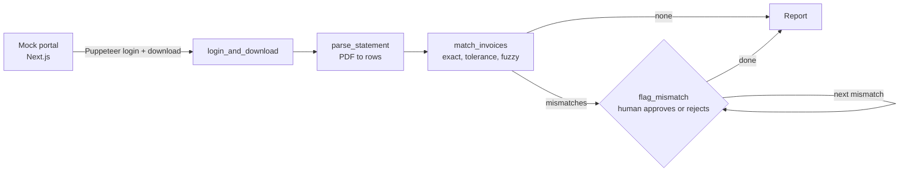

# ReconAgent

A LangGraph.js agent that logs into a vendor portal, downloads statement PDFs, reconciles them against the invoices in your books, and **pauses for a human decision on every mismatch**.

Built against a mock portal (included). It never touches a real vendor site and moves no money.

## Results

Measured by `npm run eval` against the seeded dataset: 3 vendors, 100 invoices, 99 statement lines, 12 deliberately seeded mismatches plus 11 benign differences (reference formatting, small date shifts, rounding, reference typos) that the agent should match on its own.

| Metric | Value |
| --- | --- |
| Vendors / statement lines / invoices | 3 / 99 / 100 |
| Seeded mismatches | 12 |
| Flagged | 12 |
| Precision | 100.0% |
| Recall | 100.0% |
| Auto-matched (exact / tolerance / fuzzy) | 86 / 2 / 3 |
| Time per run | 4.9 s |
| Manual estimate (assumed 15 min/vendor) | 45 min |

The 15 min/vendor manual figure is an assumption, not a measurement. Precision and recall are on synthetic data that the matcher's own rules were written against, so read them as "the pipeline works end to end", not as a real-world accuracy claim.

## How it works



- **Tools:** `login_and_download` (Puppeteer), `parse_statement`, `match_invoices`, `flag_mismatch`.
- **Matching rules** (every decision carries a reason string):
  1. Same reference (case and punctuation ignored): equal amount is `exact`, a gap up to 1.00 is `tolerance`, a larger gap is an `amount_diff` mismatch.
  2. No reference match: a single invoice with amount within 1.00 and date within 3 days is a `fuzzy` match; several candidates is `ambiguous`; none is `missing_in_books`.
  3. Invoices never seen on the statement are `missing_on_statement`.
- **Human in the loop:** the graph calls LangGraph `interrupt()` on each mismatch and resumes with your decision. State is held by a LangGraph checkpointer between steps.
- **Trace:** every node run is appended to `runs/<run-id>/trace.jsonl` with its duration and what it changed.

## Run it

Needs Node 20+.

```bash
npm run setup          # installs, generates the dataset, builds the portal
npm run reconcile      # interactive: approve or reject each mismatch
npm run reconcile:auto # no prompts, disputes everything
npm run eval           # writes eval/results.md
npm test
```

`reconcile` starts the portal on port 3111, runs the agent, and stops the portal. To point at a hosted portal instead, set `PORTAL_URL` (see `.env.example`). The demo login is `demo` / `demo-pass`.

## Layout

```
portal/        Next.js mock vendor portal (login, statement PDFs). Deploy with root = portal
src/tools/     the four agent tools
src/agent/     LangGraph graph and runner
src/dataset.ts seeded synthetic data and ground truth
eval/          precision/recall scoring and results.md
test/          matcher, parser and PDF round-trip tests
```

## What I'd do next

1. **Add an LLM for the hard cases.** Matching is fully deterministic today; there is no model in the loop. A model could explain mismatches or resolve `ambiguous` ones, with its answers cached so CI stays free.
2. **Hosted tracing and durable state.** Traces are local JSONL and the checkpointer is in memory, so a crashed run cannot be resumed. Langfuse and a SQLite or Postgres checkpointer are the natural upgrades, plus a web page for approvals instead of the CLI prompt.
3. **Messier documents.** The parser reads one clean text layout. Real statements need multi-line rows, credit notes, currencies and scanned pages (OCR).

## License

MIT
